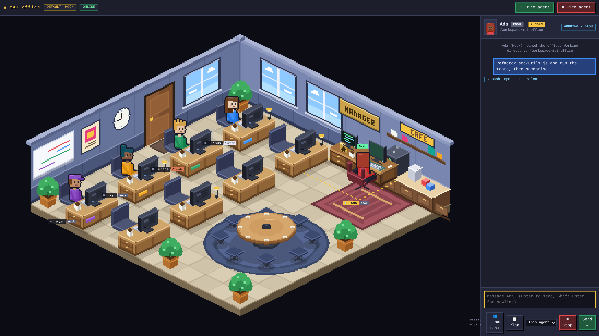

# mAI office

A pixel office on your own machine that wraps Claude Code and the Cursor CLI. Each agent is a person at a desk: you click them, type, and watch them work.



## Setup

You need Node 18 or newer, plus Claude Code (`claude`) and/or the Cursor CLI (`cursor-agent` or `agent`), installed and logged in.

```bash
git clone https://github.com/AndriSatria/mai-office
cd mai-office
npm install
npm run start:claude   # Claude Code as the default agent type
# or
npm start              # picks claude, then cursor, then mock, whichever it finds
```

Open http://127.0.0.1:3000 and click **＋ Hire agent**. Pick the agent type and the project folder it should work in.

No CLI installed? `npm run start:mock` runs simulated agents with fake data so you can try the office first.

## What it does with your Claude / Cursor actions

Every message you send runs the real CLI in print mode (`claude -p` or `agent -p`) in that agent's folder, and the office draws what the CLI reports.

| You do / the CLI does | You see in the office |
| --- | --- |
| Send a prompt | The person starts thinking. The chat shows `> your prompt`, like the terminal. |
| Read, edit, write, run Bash | The person types and their monitor flickers, with the tool name over their head. The chat gets `● Read(file)` lines with results, edit diffs and todo lists. |
| Reply | Markdown in the chat and a speech bubble over the person. A `Done in … · N turns · $…` line closes the run. |
| Subagents and background agents (e.g. `/code-review`) | Idle colleagues take the jobs and work at their own desks. Papers and envelopes fly between the desks, and the lead waits until all of them report. |
| Plan mode | The team walks to the round table. When the plan is ready they cheer and go back. |
| Slash commands | Type `/` to pick from your own commands and skills (`~/.claude/commands`, skills, plugins, project folders). The text goes to the CLI unchanged. |
| Permission modes | Shift+Tab in the message box cycles modes, like the CLI: default, accept edits and plan for Claude; default, plan and ask for Cursor. |
| Resume a session | **Sessions** lists your local Claude Code sessions and Cursor CLI chats by project. **Resume in office** seats one at a desk with its history. |
| Stop | Esc in the message box or **■ Stop** ends the run. |
| Nothing to do | Idle people stretch, read, get coffee or chat at the coffee machine. |

The first person you hire sits at the manager desk. Up to 7 people fit in the office.

### Not supported

- Terminal sessions are not live-synced. Resume copies a session's history when you click it. Later changes in your terminal do not show up.
- Cursor editor chats can't be resumed, only Cursor CLI chats.
- Interactive CLI built-ins (`/clear`, `/model`, `/resume`, login prompts) don't work, because every run is headless.
- Headless runs can't answer permission prompts. A tool the current mode doesn't allow is denied. Use accept edits, or pre-approve tools with `HARNESS_CLAUDE_ARGS`.
- The Claude and Cursor adapters are tested against fake CLIs that follow the documented output, not against a logged-in CLI.

## Settings

| Variable | Default | What it does |
| --- | --- | --- |
| `PORT` | `3000` | Port for the page |
| `HOST` | `127.0.0.1` | Bind address. Keep it on loopback: there is no login. |
| `HARNESS_MODE` | auto | Default agent type: `claude`, `cursor` or `mock` |
| `HARNESS_DEFAULT_CWD` | current folder | Folder suggested in the Hire dialog |
| `HARNESS_CLAUDE_ARGS` | none | Extra Claude args, e.g. `--model sonnet` or `--allowedTools Bash,Read,Edit` |
| `HARNESS_CURSOR_ARGS` | none | Extra Cursor args, e.g. `--model …` |
| `HARNESS_ALLOW_BYPASS` | off | `1` adds `bypassPermissions` (Claude) and `--force` (Cursor) to the Shift+Tab cycle |
| `HARNESS_PARTIAL` | off | `1` streams replies token by token |
| `HARNESS_DEBUG_EVENTS` | off | `1` saves every raw CLI event to `data/debug/` |

Agents, chats and session ids are saved in `data/agents.json`.

## Privacy

The server listens on 127.0.0.1 only and makes no outbound calls of its own; only the CLIs you run talk to their services. It reads `~/.claude` and `~/.cursor` but never writes there. Debug capture files contain your prompts, code and tool output, so delete them when you are done.

## More

[docs/DETAILS.md](docs/DETAILS.md) covers the renderer, the adapter internals and event shapes, the WebSocket protocol, tests and screenshot scripts.
