# mAI office: technical details

The short version is in the [README](../README.md). This file keeps the full notes: rendering, adapter internals, event shapes, tests.

**mAI office** is a pixel-art office where every **Claude Code** / **Cursor** agent is an animated little person at its own desk.
Click a person, type to them, and your message goes to that agent's Claude Code session; the reply streams back
into a chat panel and a speech bubble over their head.

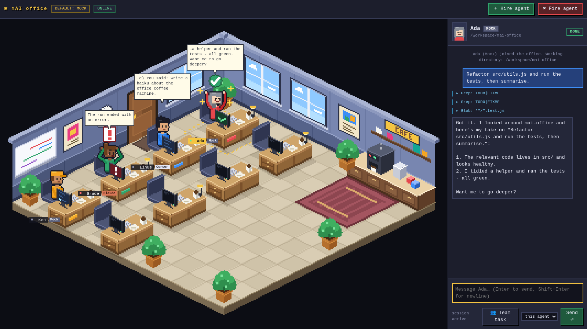

* **Backend:** Node.js, `express` + `ws`. **Frontend:** one HTML page + plain `<canvas>`, no build step.
* **Art:** 100% procedural pixel-art **isometric (2:1 dimetric)** office drawn on a 400×264 logical `<canvas>`
  and upscaled by a whole-number factor with `imageSmoothingEnabled = false`. No assets. (`?view=flat` = the old top-down view.)
* **Agent types** (chosen per agent when hiring): `claude` (Claude Code CLI), `cursor` (Cursor CLI agent) or `mock`
  (simulated, no CLI). Each agent shows a small type badge under its name and in the chat header.
* **Lively idle agents:** idle people stretch, read, look around, sip coffee, or meet up for a chat by the coffee machine.

## Isometric view

The office is a 12×12 tile room seen from the south: diamond tile floor (32×16 px tiles), two back walls (windows,
wall clock, posters, whiteboard, a shelf with a CAFE sign), 6 desks in two rows (monitor, keyboard, mug, lamp,
drawers, chair), a larger **manager desk** for the main agent, a **round table** with 8 chairs in the open middle, plants, and a coffee corner (counter, machine, kettle, mugs, rug).

* **Projection:** `sx = ox + (x − y)·16`, `sy = oy + (x + y)·8 − z`. +x runs down-right, +y down-left. Everything is
  drawn with `fillRect` / a tiny pixel-exact polygon filler, so edges are crisp and neighbouring faces never leave gaps.
  The canvas is scaled by an **integer** factor only (×3 at 1600×900).
* **Characters** are drawn in a 3/4 view with **4 facings** (SE, SW, NW, NE; two are mirrored versions of the others,
  and back views show the back of the head). All states and idle activities work in every facing: idle bob, thinking
  (hand on chin + dots), working (typing + tool chip + live monitor), done (arms up, ✓), error (`!`, red monitor),
  stretch, read, look around, coffee sip, and the two-person chat on the rug.
* **Walking:** agents walk on the tile grid. `walkPath(slot, spot)` is a 4-neighbour BFS over a `blocked[y][x]` grid
  (desks, chairs, counter, plants), so they never cut through furniture; the facing follows the walking direction.
* **Depth sorting:** objects (chairs, desks, plants, people) have tile footprints; an object is drawn before another when
  it lies fully behind it along x or y, falling back to tile x+y. The same painter order, reversed, drives hit testing,
  so the front-most thing under the cursor wins (a walker in front of a desk beats the desk).
* **Hover / selection:** an isometric dashed diamond around the desk pod (white = hover, animated yellow = selected,
  green + “＋ hire” on an empty desk), plus an ellipse under a selected agent who is away from the desk.
* **Overlays** (name pill, type badge, tool chip, queued pill, speech bubbles) are drawn at full resolution on top of the
  scaled canvas, anchored to projected points.
* **Flat view:** `http://localhost:3000/?view=flat` still gives the original top-down renderer (`office-flat.js`); it shows helpers working from their own desks.

## Manager desk, monitors and the round table

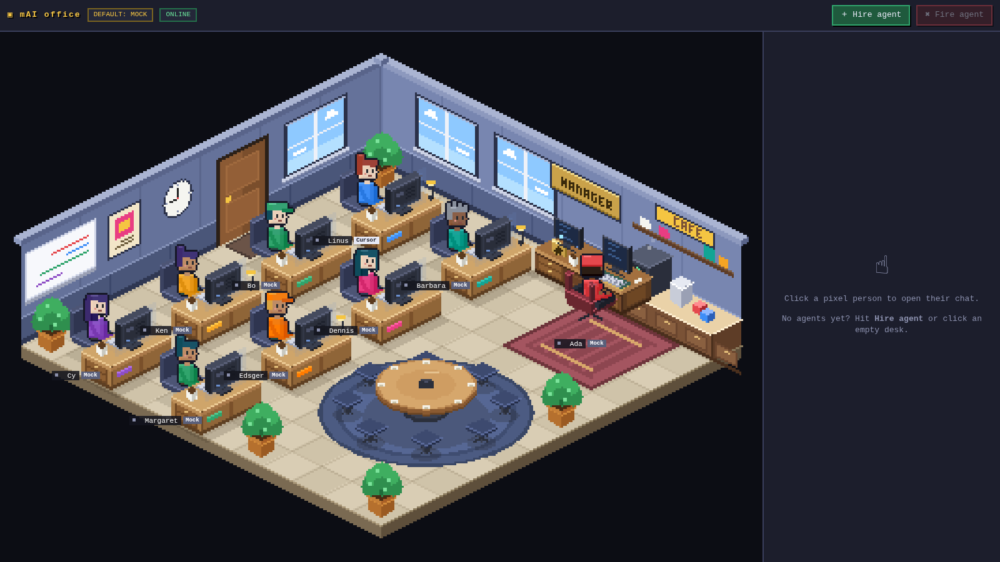

**Main agent = manager desk.** The back-right corner has one bigger walnut desk with a brass MANAGER sign, one screen, a folder stack, a pen cup, a
leather chair and a rug. The **first agent you hire is the main agent** and sits there (clicking the empty manager desk opens
the Hire dialog with a note). Everyone else gets a regular desk. Select any other agent and press **★ Make main** to promote
them: they swap desks with the current main agent (persisted; the selected main agent shows a **★ main** badge). Firing the
main agent promotes the next one automatically. The manager is also the last person picked as a helper in `/code-review` style jobs.

**Monitors face the person.** Every regular monitor now sits *in front of* the seated person: its screen faces them and
its **back faces the camera**. The state therefore can't be read off the screen anymore, so it is shown three other ways:
a glow halo + status LED + light bar on the back of the monitor (violet pulse = thinking, flickering green/cyan = working,
steady green = done, flashing red = error, dim blue = idle), the same colour washing over the desk top, the keyboard and the
person's face, and the usual tool chip over the head. The manager sits with their back to the camera facing one screen
that faces the manager (and so the camera), where the screen itself shows the state. Depth sorting is footprint based so the monitor correctly overlaps the person
where it is in front of them.

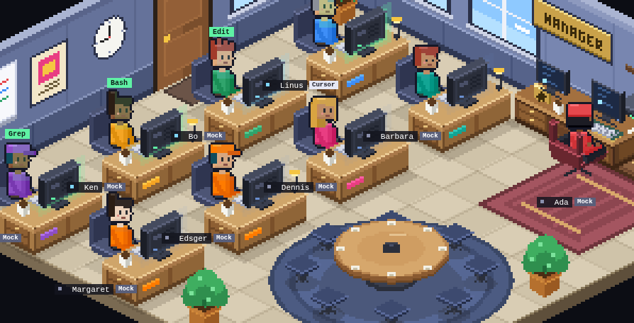

**Round table + plan mode.** The middle of the room has a round table with 8 chairs (a rug, paper pads and a speaker puck).
When a Claude Code agent goes into **plan mode** the team gathers there:

| Step | What happens |
| --- | --- |
| Detect | init event `permissionMode: "plan"` (the agent is run with `--permission-mode plan`), or an `ExitPlanMode` tool call. `/plan <task>` runs a one-shot plan-mode run for any agent type (the Cursor adapter passes `--mode plan`, best effort). |
| Gather | the plan owner (main or any agent) walks to the table; every **idle / done** colleague (not helping, nothing queued, not selected) walks over and sits. Busy workers and helpers stay at their desks. Coffee and chat trips are suppressed while the team is gathered. Paths avoid furniture. |
| Planning | a floating plan document in the middle with sparkles, thinking bubbles ("…", "?") over the people, a "planning…" pill and an amber ring on the floor. |
| Ready | `ExitPlanMode` (or the end of the plan-mode run) turns the document green with a check, shows **✓ PLAN READY** and a summary bubble over the table; the team cheers. After ~6 s everyone walks back to their desk. |

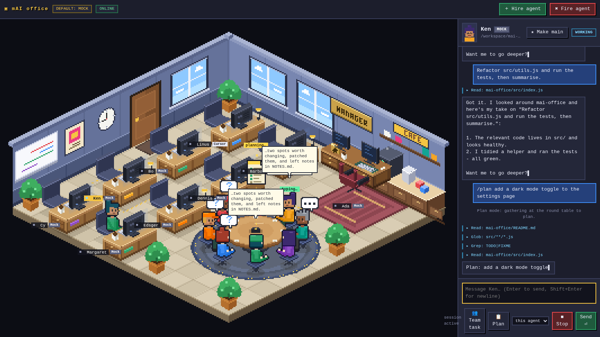
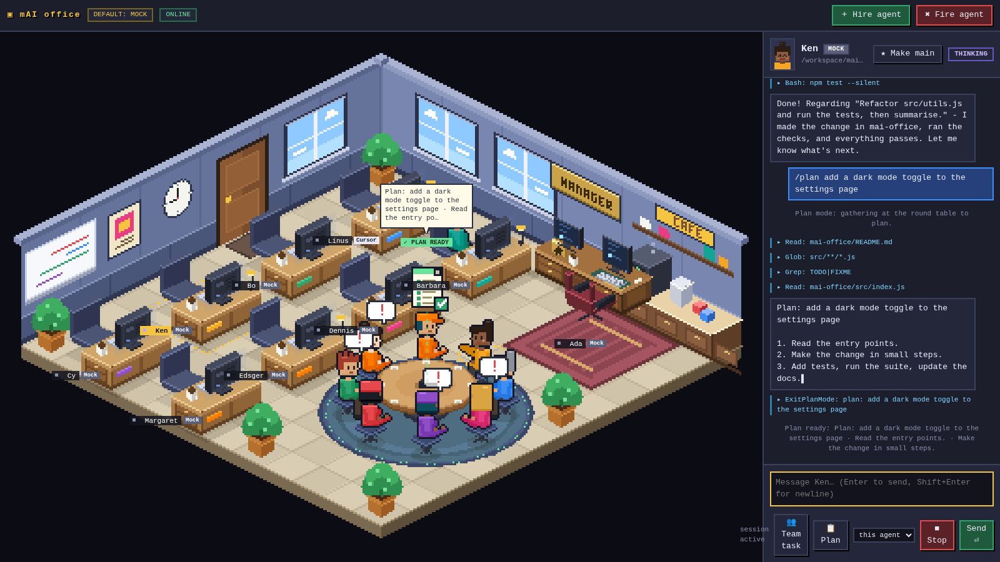

Turn plan mode on per agent: the **Permission mode** select in the Hire dialog, or the **📋 Plan** toggle in the chat header
(sticky for that agent's next runs). In mock mode type `/plan add a dark mode toggle` to see the whole flow.

## Team collaboration: colleagues help each other

One project, several agents: when an agent runs work in parallel (a Claude `Task`/`Agent` fan-out such as `/code-review`, Cursor helper tasks,
or the mock's simulated team) the helpers are **the people who already work in the office**. Nobody pops in or fades out, and **nobody walks over to the
lead**: every helper does the job **at their own desk**, and the exchange is drawn between the desks.

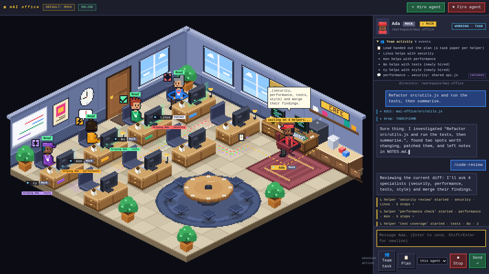
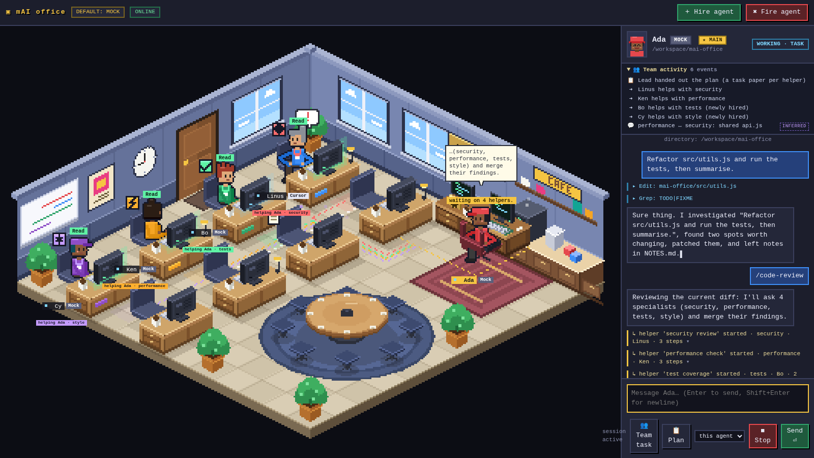
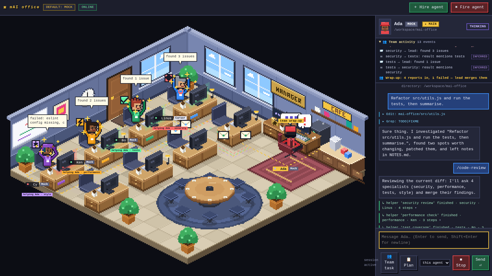
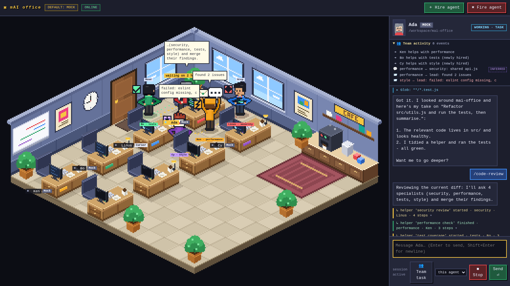

* **Who helps:** each subagent is assigned to an existing colleague, **idle ones first** (fewest times helped first). If that person is away (coffee, chatting)
  they **walk back to their own desk and sit** before the job shows; idle wandering is suppressed while they help and resumes afterwards. If nobody is idle a
  new regular, persistent agent is **auto-hired** (max 6 desks + the manager desk, mock type): it **walks in through the entrance door to its own desk** and stays there. If the office
  is full the subagent waits (pending) and is assigned when somebody frees up. In the flat view helpers also just work from their own desks.
* **Helping status (at the helper's desk):** a temporary **role badge + coloured lanyard/ID card** (no new look), a **tool chip**, typing animation, monitor flicker,
  a glowing pad on the floor in front of the desk and a **"helping <lead> · role"** tag under the name.
* **Communication without moving:** **dotted isometric lines** run along the aisles from the lead's desk to every helper desk (one lane per helper so lines do
  not lie on top of each other; routes are checked in `test-iso` never to cross furniture). A **paper** flies lead → helper along its line at hand-off, and an
  **envelope with a short summary bubble** ("found 3 issues", failures show `!`) flies helper → lead when it finishes; small bubbles appear at each desk.
  Inferred peer interactions (two helpers on the same file) are a **white dotted line + `?`/`!`/`…` bubbles + a letter between the two desks**.
* **Wrap-up (replaces the huddle):** when the last helper has reported, every helper desk celebrates **at the same time** (gold ring, sparkles, check mark, arms up),
  the lead gets a "team wrap-up" chip and the consolidated bubble. Afterwards everybody simply drops the helper state, still sitting, and idle behaviour resumes.
* **Roles** (`lib/roles.js`) come from the Task input (`subagent_type`, then description, then prompt) by keyword: `security` (red), `performance`
  (orange), `tests` (green), `style` (purple), `docs` (blue), `architecture` (pink), `explore` (cyan), otherwise `general` (grey); each has a small icon in its badge.
* **Messages to a helping colleague** are queued (`+N queued` pill) and run after the helper job ended (+ a short hold). Their transcript only gets one
  system line, `helped <parent>: <label>`. The chat header shows "helping <parent> · role".
* **Inferred interactions.** Claude subagents cannot message each other, so these are *inferred from the event stream* and labelled **inferred** (tooltip on
  the person, the "Team activity" feed and this file). They never change what the agents actually do:
  1. two helpers that touch the **same file/pattern** within a time window turn their heads toward each other and trade `?` / `!` / `…` bubbles over the
     dotted desk-to-desk line (throttled: one pair at a time, a cooldown per pair, max 6 per run);
  2. when a helper ends it **hands an envelope to the lead** with a short summary, plus a **letter to another helper** if its result text mentions that helper's role;
  3. the lead **announces the plan** (clipboard icon, a paper per helper) at the start and holds the **team wrap-up** (celebration at every helper desk, "team wrap-up" chip,
     consolidated bubble) once the last helper has reported.
* **Chat panel:** every helper is one collapsed line (`↳ helper 'label' started · role · helperName · N steps`) and a collapsible **👥 Team activity**
  feed per lead lists the plan, assignments, peer chats, handoffs, mentions and the wrap-up; inferred entries carry an `inferred` tag with the reason.
* **Mock mode:** `/code-review` (4 role helpers with overlapping files and different durations, one fails, then a consolidated summary), `/team <task>`
  (3 helpers), a message containing "in parallel"/"subagents" ("fail" makes the last one fail), or the **👥 Team task** button. `scripts/fake-claude.js`
  emulates the current background `/code-review` (4 `Agent` calls, see below); "foreground" in the prompt gives the older 4-`Task` shape.
* **Events** (normalized adapter events): `subagent_start {subId,label,kind,hint}`, `subagent_activity`, `subagent_end {subId,ok}`. A `Task`/`Agent`
  `tool_use` starts a subagent, events with `parent_tool_use_id` are its activity, the matching `tool_result` ends it (`is_error` = failed). Background
  agents (Claude Code runs `Agent` calls in the background by default) answer at once with an `Async agent launched` tool_result
  (`tool_use_result.status: 'async_launched'`); that does not end the helper. It ends on `system/task_notification` (or `task_updated` with a final
  `patch.status`, or a `<task-notification>` user message); `system/task_progress` is its activity and `system/task_started` without a tool_use also starts
  one. A `result` that arrives while background agents are out is held, so the lead stays **working** ("waiting for N background agents") until the next
  `result` or until the CLI exits (helpers still out then end as failed). Cursor is best
  effort (tool calls named `task`/`subagent`/`agent`). Harness → client: `subagent {op:'start'|'assign'|'activity'|'end',id,sub}` (end carries `ok`, `short`,
  `helperId`), `team {id,entry}` / `team {id,reset}` (entry kinds `plan assign note peer handoff mention huddle`, each with `inferred`, `text`, `why`), and
  `agent` updates carrying `helping {parentId,parentName,subId,label,role,kind}`, `autoHired` and `subs[].role/helperId`. Client→server: `relay {from,to,text}`.
* **Send to another agent:** pick a colleague in the select next to **Send** and the message is delivered as `[from <name>] …` with a flying letter.
* **Pacing:** `HARNESS_SLOW=N` stretches the server timers (release/hold/inference windows and the mock's timings), `?slow=N` stretches walking speed and bubble
  lifetimes in the page. The demo videos use 2 (`DEMO_SLOW`).

**Demo videos:** `demo/mai-office-demo.mp4` and `demo/mai-office-demo-codereview.mp4` were recorded **before** the "helpers stay at their own desks" change
and still show helpers walking to the lead, so they are **outdated** (not re-recorded). `npm run demo:videos` re-records them (mock mode, Playwright `recordVideo` + ffmpeg).

**Not verified against real CLIs:** the Claude `Task` / `parent_tool_use_id` handling follows the documented stream-json shape and is only tested with
`scripts/fake-claude.js`; the Cursor helper shape is a guess; role derivation, the inferred interactions, assignment/auto-hire and relay were exercised with the
mock and fake CLIs only. The background-agent shapes come from the Agent SDK type definitions and the CLI bundle, not a captured run; to check
yours, start with `HARNESS_DEBUG_EVENTS=1`, run `/code-review` on a Claude agent and read the newest file in `data/debug/`.

## Run

```bash
npm install
npm start            # http://127.0.0.1:3000  (PORT=4000 npm start to change the port)
```

`HARNESS_MODE` sets the **default agent type** preselected in the Hire dialog (and used for agents saved without one).
If unset it is auto-detected: `claude` on `PATH` → `claude`, else `cursor-agent` on `PATH` → `cursor`, else `mock`.

```bash
HARNESS_MODE=mock   npm start      # simulated agents, no CLI needed
HARNESS_MODE=claude npm start      # real Claude Code (needs `claude` installed & logged in)
HARNESS_MODE=cursor npm start      # Cursor CLI agent (needs `cursor-agent` installed & logged in)
```

All three types can be mixed in one office - pick the type per agent in the **Hire agent** dialog
(types whose CLI isn't found are flagged "CLI not found"). The type is persisted with the agent.

### Resume your local Claude Code sessions and Cursor CLI chats

The office can read the Claude Code sessions and Cursor CLI chats on your own PC and continue one at a desk.

```bash
git clone https://github.com/AndriSatria/mai-office
cd mai-office
npm install
npm run start:claude
```

Open http://127.0.0.1:3000 and click **Sessions**, then the **Claude Code** or **Cursor CLI** tab (arrow keys switch tabs). Sessions are grouped by project folder, newest first. **Resume in office**
puts a Claude Code agent at a free desk with the recent history in its chat; your next message runs
`claude -p ... --resume <session id>` in that project folder, so Claude picks up where you left off.

* Sessions are read from `~/.claude/projects/*/*.jsonl` (or `$CLAUDE_CONFIG_DIR/projects`). The folder is only read, never written.
* Cursor CLI chats: each chat's `meta.json` (title, folder, times) is read from `~/.cursor/chats/<md5 of folder>/<chat id>/`
  (or `$CURSOR_CONFIG_DIR/chats`, `$XDG_CONFIG_HOME/cursor/chats`), the history from
  `~/.cursor/projects/<folder slug>/agent-transcripts/<chat id>/<chat id>.jsonl` (or `$CURSOR_DATA_DIR`). **Resume in office** puts a Cursor
  agent at a free desk; your next message runs `agent -p ... --resume <chat id>` in the chat's folder (the CLI only finds a chat from
  the folder it was started in). `store.db` (SQLite) is never opened, so no extra dependency.
* Not listed: Cursor **editor** chats (they live in the editor's `state.vscdb`; `agent --resume` can't open them, the dialog says so),
  chats without `meta.json` or a `cwd` in it (older CLI builds; the folder can't be recovered from the md5 name), subagent chats,
  never-used chats, and chats whose folder name doesn't match `md5(cwd)`. A chat with no transcript file is listed as "no local transcript".
* If the office is full (7 people), fire someone first.
* The list is only served to `localhost` / `127.0.0.1` pages. Do not bind `HOST` to a public address on a machine with sessions you care about.


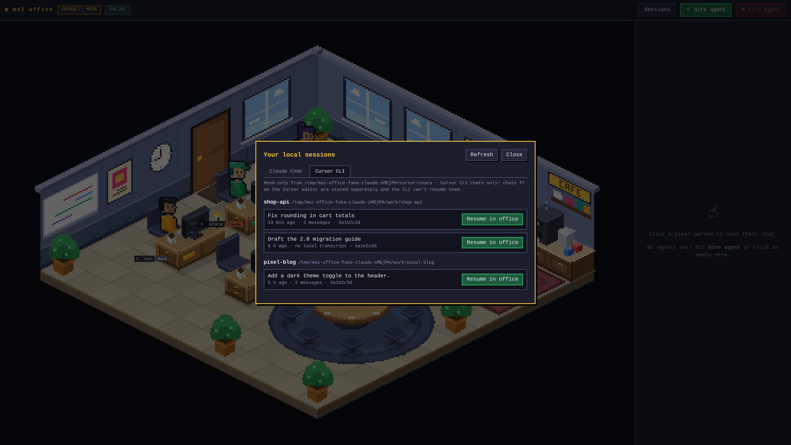

### Slash commands and permission modes

Type `/` at the start of an agent's message box to pick a command (arrows, Enter or Tab, Esc, or click). The text
you send, e.g. `/frontend:component Button`, goes to `claude -p` unchanged, so Claude Code expands it as usual.
The list is read (never written) from:

| Source | Where | Shown as |
| --- | --- | --- |
| user commands | `~/.claude/commands/**/*.md` (`sub/x.md` becomes `/sub:x`) | `user` |
| user skills | `~/.claude/skills/*/SKILL.md` (`user-invocable: false` hidden) | `user skill` |
| project | `<agent folder>/.claude/commands/**/*.md`, `<agent folder>/.claude/skills/*/SKILL.md` | `project` |
| plugins | `~/.claude/plugins/installed_plugins.json` install paths: `commands/*.md`, `skills/*/SKILL.md`, as `/plugin:name` | `plugin` |
| Claude Code itself | `slash_commands` + `skills` from the last run's init event, minus interactive-only ones (`/clear`, `/model`, …) | `session` |
| Cursor agents | the folders `cursor-agent` loads: `~/.cursor/commands/*.md`, `~/.claude/commands/*.md`, `<agent folder>/.cursor/commands/*.md`, `<agent folder>/.claude/commands/*.md` (flat, no sub folders), skills in `<agent folder>/.cursor/skills`, `<agent folder>/.claude/skills`, `~/.cursor/skills`, `~/.claude/skills` | `project` / `user` |
| the office | `/plan <task>` (one plan-mode run), mock agents also get `/team` | `office` / `demo` |

The description is the frontmatter `description:` or the first line of the file; `argument-hint:` is shown next to
the name. For Cursor, the CLI's own commands (`/model`, `/resume`, `/plan`, …) are interactive-only and its init event
has no command list, so they are not offered. The Cursor folders come from the CLI bundle's loader; that `-p` runs expand a
`/name` prompt is read from the bundle, not run against a logged-in CLI (`shortcut` in `lib/slash-commands.js`). Built-in CLI commands are only listed once Claude Code reports them in its init event, since which ones work
with `-p` depends on the version. The list is served at `GET /api/agents/:id/commands`, to `localhost` pages only.

Under the box a line shows the agent's permission mode, like the CLI: `▸▸ accept edits on (shift+tab to cycle)`.
Shift+Tab in the box (or a click on the line) cycles `default → acceptEdits → plan → default`; `bypassPermissions`
joins the cycle only with `HARNESS_ALLOW_BYPASS=1`. The mode is saved per agent and passed as `--permission-mode` on
the next run. Plan mode still gathers the team at the round table.

Cursor agents cycle `default → plan → ask → default`, mapped to the print-mode flags in `agent --help`:

| Mode | Flag | Effect (Cursor docs) |
| --- | --- | --- |
| `default` | none | edits are only proposed, not applied ([headless docs](https://cursor.com/docs/cli/headless)) |
| `force` | `--force` | applies edits and runs commands; joins the cycle only with `HARNESS_ALLOW_BYPASS=1` |
| `plan` | `--mode plan` | read-only planning; the team gathers at the round table |
| `ask` | `--mode ask` | read-only questions and answers |

`--auto-review` is not offered: it asks before some tool calls, and a headless run can't answer.

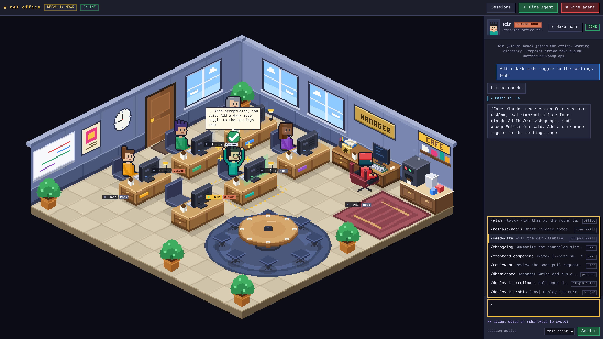
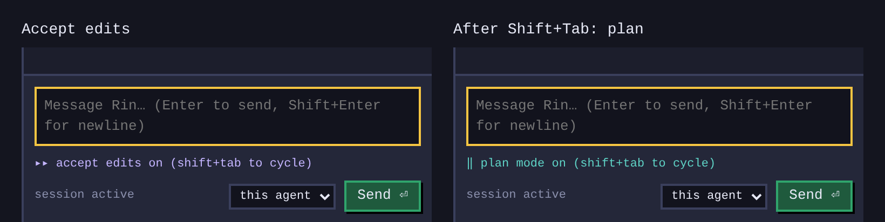
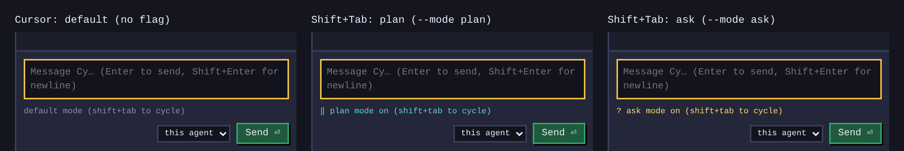

### Chat panel (Claude Code style)

The transcript reads like the Claude Code terminal in the office palette: `> prompt` on a band, `●` + markdown for replies
(headings, bold/italic, inline code, fenced code with a language label, lists, links, tables), `● Read(src/app.js)` tool lines
with a dim `⎿ Read 120 lines` result (long output folds to `… +N lines`, click or Enter to expand), +/- diffs for Edit/Write with
file line numbers when Claude sends a `structuredPatch`, a checklist for TodoWrite, `● Agent(label)` helpers grouped on one rail with
the colleague who took the job (and a `background` tag), a collapsed `✻ Thinking…` block, a `Done in 48.2s · 7 turns · $0.0832`
line and a `✻ Pondering… (12s · esc to interrupt)` status line above the input (Esc in the message box stops the run).
Markdown is parsed by `public/js/chatfmt.js` (no dependencies) and only ever written with `textContent`; links must be absolute http(s).
Cursor agents get the same tool lines and output (no diffs or todos: its stream doesn't carry them); mock agents send fake tool data.

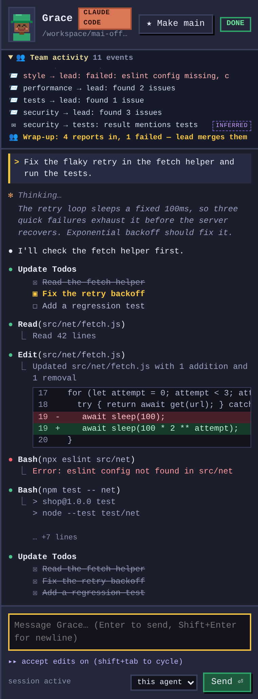
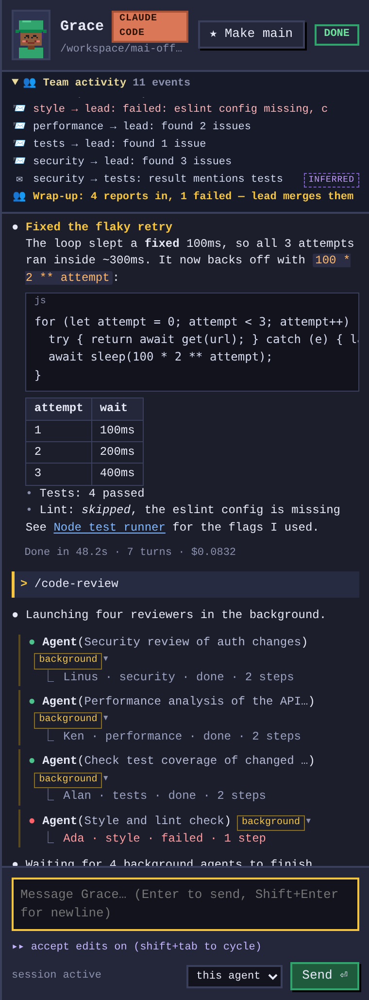

### Using it

| Action | How |
| --- | --- |
| Select an agent | Click the person (or their desk). Chat panel opens on the right. |
| Talk to it | Type in the box, **Enter** to send (Shift+Enter = newline). Messages sent while it's busy are queued. |
| Hire | **＋ Hire agent** (or click an empty desk): name, agent type (Claude Code / Cursor / Mock), working directory, permission mode (normal / plan). Up to 7 people: 6 desks + the manager desk (the first hire). An older data file with more people is trimmed on load; the full file is kept next to it as `.bak`. |
| Fire | Select an agent, **✖ Fire agent**. |
| Stop a run | **■ Stop** in the chat panel (kills the CLI process). |
| Make main | Select an agent, **★ Make main** (swaps desks with the current main agent at the manager desk). |
| Plan mode | **📋 Plan** toggle in the chat header, or type `/plan <task>` (one-shot). The team gathers at the round table. |

Agent states and what you see:

| State | Trigger | Visuals |
| --- | --- | --- |
| idle | nothing running | subtle bob + blinking, plus random idle activities (below) |
| thinking | run started / waiting on model | thought bubble with animated dots, hand on chin |
| working | tool use or streaming text | typing arms, flickering code on the monitor, green chip with the tool name (`Bash`, `Edit`, …) |
| done | `result` event | green ✓, sparkles, arms up, smiling |
| error | CLI/run error | red `!`, worried face, red monitor, error shown in chat + bubble |

### Idle behaviour

Agents that are idle and not selected/hovered pick a random activity every ~8-22 s (weights in `pickActivity`, `public/js/app.js`):

| Activity | What you see |
| --- | --- |
| stretch | arms up, yawn |
| read | holds a little book, turns pages, looks down |
| look around | head/eyes glance left and right |
| coffee | walks to the coffee machine, sips from a mug, walks back |
| chat | two idle agents walk to the coffee machine and talk, alternating small speech-bubble icons (`...`, `!`, `?`, ♥, ♪) |

Only one coffee/chat trip at a time. Selecting an agent or giving it work (state ≠ idle) sends it back to its desk
(a chat ends for both). URL flags: `?wander=off` disables all idle behaviour, `?wander=fast` makes it happen every few seconds.
For demos/tests the console exposes `harness.forceActivity(id, 'stretch'|'read'|'look'|'coffee'|'chat', partnerId)`.

## Claude mode details

For every message the server spawns (cwd = the agent's working directory):

```
claude -p --output-format stream-json --verbose --permission-mode acceptEdits \
       [--resume <session_id>] [--include-partial-messages] -- "<your message>"
```

The first run's `system/init` (or `result`) event gives a `session_id`, stored on the agent (and persisted), and
passed to `--resume` on later messages so the conversation continues. Parsed events:

* `assistant` → `text` blocks become chat replies; `tool_use` blocks → **working** + tool label + a `▸ Tool: summary` line
* `user` → `tool_result` → back to **thinking**
* `stream_event` text deltas (only with `HARNESS_PARTIAL=1`) → live token streaming
* `result` → **done** (or **error** if `is_error`)

Environment knobs:

| Var | Default | Meaning |
| --- | --- | --- |
| `PORT` | `3000` | HTTP/WebSocket port |
| `HOST` | `127.0.0.1` | bind address (keep it loopback unless you know what you're doing) |
| `HARNESS_MODE` | auto | `claude` or `mock` |
| `HARNESS_CLAUDE_BIN` | `claude` on PATH | path to the CLI |
| `HARNESS_PERMISSION_MODE` | `acceptEdits` | the mode new agents start in (each agent's mode is then switched in its chat and passed as `--permission-mode`). Headless runs can't answer permission prompts, so tools not pre-approved are denied, add e.g. `HARNESS_CLAUDE_ARGS="--allowedTools Bash,Read,Edit"` |
| `HARNESS_ALLOW_BYPASS` | off | `1` adds `bypassPermissions` to the Shift+Tab cycle (dangerous) |
| `HARNESS_CLAUDE_ARGS` | – | extra whitespace-separated CLI args (`--model sonnet` …) |
| `HARNESS_PARTIAL` | off | `1` adds `--include-partial-messages` |
| `HARNESS_DATA` | `data/agents.json` | where agents + transcripts + session ids are persisted |
| `HARNESS_DEFAULT_CWD` | server cwd | default working dir in the Hire dialog |
| `HARNESS_DEBUG_EVENTS` | off | `1` writes every raw stream-json line of each Claude/Cursor run to `data/debug/<agent>-<cli>-<UTC time>.jsonl` (gitignored). These files can contain your code, prompts and tool output: delete them when done |

> ⚠️ **Claude mode is untested against a real CLI.** It was written from the documented flags; `claude` was not
> installed where this prototype was built. It *was* exercised end-to-end (state machine, `--resume` capture,
> tool labels) with `scripts/fake-claude.js`, a stand-in that emits the documented stream-json shape:
> `HARNESS_MODE=claude HARNESS_CLAUDE_BIN=$PWD/scripts/fake-claude.js npm start`.
> Run `claude --help` and adjust `lib/adapters/claude.js` if your CLI version differs.

## Cursor mode details

Per message, with cwd = the agent's working directory (from the [Cursor CLI docs](https://cursor.com/docs/cli/reference/output-format)):

```
cursor-agent -p --output-format stream-json [--stream-partial-output] [--mode plan|ask | --force] --trust [--resume <chatId>] -- "<your message>"
```

The binary is looked up as `cursor-agent`, then `agent` (newer installs), or `HARNESS_CURSOR_BIN`. Event mapping:

* `system/init` (`session_id`) → remembered, passed as `--resume` next time
* `assistant` → chat reply (one event per message segment; with `HARNESS_PARTIAL=1` only the `timestamp_ms`-without-`model_call_id` deltas are used for live streaming, duplicates skipped)
* `tool_call` `started` → **working** + tool label (`shellToolCall` → `Shell`, `readToolCall` → `Read`, `editToolCall` → `Edit`, …) and a `▸ Shell: npm test` line; `completed` → back to **thinking**
* `result` → **done** (or **error** when `is_error` / non-success); a non-zero exit without a result → **error** with stderr

`HARNESS_CURSOR_ARGS` adds extra args (`--model …`, `--force` to let it run shell commands without prompting - dangerous).

> ⚠️ **Cursor mode is not run against a logged-in `cursor-agent`**: the flags were checked with `agent --help` (2026.10.22) and the chat
> layout read from its bundle, but no real chat was sent (no login here). The plan-ready detection is a guess. It is covered by `npm run test:adapters`, which drives claude/cursor/mock agents through the real server using
> `scripts/fake-claude.js` and `scripts/fake-cursor-agent.js` (also usable as `HARNESS_CURSOR_BIN` for manual demos).

## Security notes

The server can make Claude Code run in any directory you give it. It binds to loopback by default and rejects
cross-origin WebSocket connections, but there is **no authentication**, don't expose it to a network.

## Project layout

```
server.js                 express static + WebSocket hub
lib/harness.js            agent registry, state machine, persistence, message queue, helper assignment / auto-hire, team feed
lib/roles.js              role derivation from Task input + file-overlap / mention inference helpers
lib/adapters/claude.js    Claude Code CLI adapter (stream-json)
lib/adapters/cursor.js    Cursor CLI agent adapter (stream-json)
lib/claude-sessions.js    read-only Claude Code session reader
lib/cursor-sessions.js    read-only Cursor CLI chat reader (meta.json + transcript JSONL)
lib/adapters/mock.js      simulated agent
lib/tool-data.js          the capped tool input/result fields the chat draws (paths, commands, old/new strings, todos, patches)
lib/adapters/index.js     adapter registry, per-type availability, default type
public/index.html, style.css
public/js/office-iso.js   isometric renderer (default): projection, furniture, 4-facing characters, depth sort, hit test, pathfinding
public/js/office-flat.js  the original top-down renderer (`?view=flat`); also supplies shared bubble/icon helpers
public/js/chatfmt.js      chat formatting: markdown parser, diffs, tool/todo/helper lines (also loaded by scripts/test-chat.js)
public/js/app.js          WebSocket client, chat panel, wandering logic, plan-mode gathering (`updateMeeting`)
scripts/screenshots.js    Playwright demo: hires, chats, screenshots → screenshots/ (screenshots-hd.js: 3840×2160; team-shots.js: shared /code-review beats, plan-shots.js: manager desk / round table beats)
scripts/fake-claude.js    fake `claude` binary for adapter testing
scripts/fake-cursor-agent.js  fake `cursor-agent` binary
scripts/test-iso.js       Playwright geometry tests: iso hit testing, paths, depth order, mouse (`npm run test:iso`)
scripts/demo-video.js     records demo/mai-office-demo.mp4 and demo/mai-office-demo-codereview.mp4 (`npm run demo:videos`)
scripts/test-adapters.js  end-to-end test of all agent types + type persistence (`npm run test:adapters`)
```

WebSocket protocol, client→server: `hire {name,cwd,agentType}`, `fire {id}`, `send {id,text}`, `interrupt {id}`, `relay {from,to,text}`, `promote {id}`, `permission {id,mode}`, `resume {sessionId,source:'claude'|'cursor'}`; `hire` also takes `permissionMode` and `slot`;
server→client: `snapshot`, `agent` (state/tool updates), `removed`, `msg`, `msg_update` (streamed text), `msg_patch` (tool result/status), `subagent`, `team`, `relay`, `error`.

## Regenerate screenshots

```bash
npm install && npx playwright install chromium
npm run screenshots     # uses the fake claude/cursor CLIs so all agent types appear
```

Shots: `01`-`09` (hiring, thinking, working + chat, error, done + reply bubble, wandering, coffee break, fire),
`10-idle-stretch-read-look`, `11`/`11b-idle-chat-at-coffee`, `12-hire-dialog-agent-type`, `13-flat-view-fallback` (`?view=flat`),
`14-hover-empty-desk`, `15-team-code-review-4-helpers`, `16-team-peer-conversation`, `17-team-huddle`, `18-team-result-handoff`, `19-agent-to-agent-letter`, `20-manager-desk-and-round-table`, `21-monitors-face-the-people` (clip), `22-plan-mode-gathering`, `23-plan-ready-summary`. (`17-team-huddle` is the synchronized wrap-up; `07-wandering` is the walking agent.)

**HD shots:** `npm run screenshots:hd` renders a 1920×1080 viewport at deviceScaleFactor 2 and saves 3840×2160 PNGs to `screenshots/hd/`
(idle variety, working + tool chip, thinking + done bubble, coffee chat, `05`-`08` team: /code-review with 4 helpers, peer conversation, wrap-up, result handoff, `09` manager desk + round table, `10` monitors close-up, `11` plan gathering, `12` plan ready + summary, `13` Claude sessions browser built from a fake Claude folder). The canvas backing store is in device pixels with an integer
scale (×7 at DPR 2), so nothing is resampled; the script asserts this before capturing. Tests: `npm run test:iso` (needs Playwright) and `npm run test:adapters`.

## Known limitations / ideas

* Max 7 agents (6 desks + the manager desk); fixed office layout; the isometric camera is fixed (no rotation/zoom); bubbles of different agents can overlap.
* Claude and Cursor modes are untested with the real CLIs; plan-mode detection (`permissionMode: plan` in init, `ExitPlanMode` tool use) is only exercised through `scripts/fake-claude.js`, Cursor flags are from `agent --help` but not run logged in; no tool-permission prompts in headless mode; one process per message.
* No auth; long transcripts are capped at 300 messages per agent.
* Next: `/clear`/new-session button, per-agent model settings, sound, day/night cycle.
